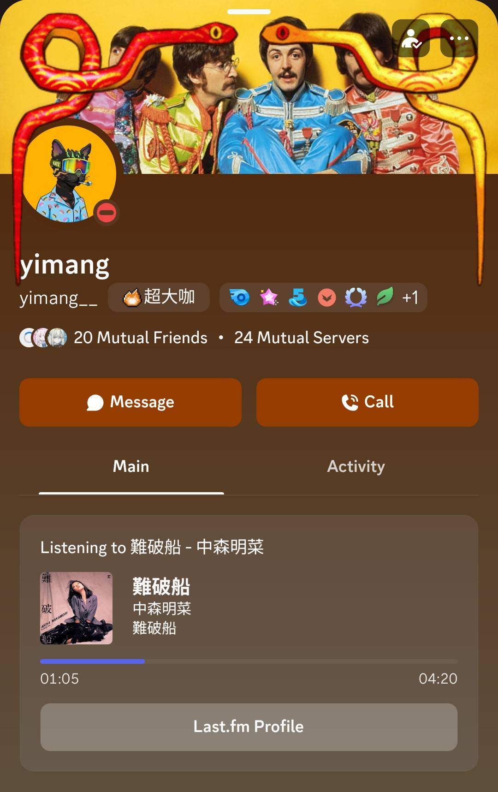

# Last.fm Discord RPC 24/7
> [!WARNING]
> This project uses a selfbot (user token), which is against [Discord's Terms of Service](https://discord.com/terms). Use at your own risk — your account may be suspended if detected.

Sync your currently playing music from Last.fm to your Discord profile in real time, 24/7, without keeping any client open.

> Modified from [Vencord LastFMRichPresence](https://vencord.dev/plugins/LastFMRichPresence).



## How It Works

The service polls the Last.fm API every 5 seconds for your currently scrobbling track and updates your Discord presence via a selfbot. It runs on a VPS so it keeps working even when your computer is off — just listen to music on any device and Discord updates automatically.

Track lengths for the progress bar come from Last.fm first, then fall back to the free iTunes Search API and MusicBrainz when Last.fm has no usable duration. Resolved durations are cached in `data/duration-cache.json` (mounted as a volume in Docker) so they survive restarts.

## Prerequisites

- [Last.fm](https://www.last.fm) account
- [Last.fm API Key](https://www.last.fm/api/account/create) (free)
- Discord user token (see [guide](https://www.reddit.com/r/discordapp/comments/1h7isk5/how_could_i_find_my_discord_token_every_guide/))
- Discord Application (create at [Discord Developer Portal](https://discord.com/developers/applications))

## Setup

Copy `.env.example` to `.env` and fill in the 3 secrets:

```env
DISCORD_TOKEN=your_discord_user_token
DISCORD_CLIENT_ID=your_discord_application_id
LASTFM_API_KEY=your_lastfm_api_key
```

Edit `config.json` to set your preferences:

```json
{
  "username": "your_lastfm_username",
  "shareUsername": false,
  "clickableLinks": true,
  "hideWithSpotify": true,
  "hideWithActivity": false,
  "statusName": "some music",
  "statusDisplayType": "artist",
  "nameFormat": "song-first",
  "useListeningStatus": true,
  "missingArt": "lastfmLogo",
  "showLastFmLogo": true,
  "showAlbumCover": true,
  "showProgressBar": true
}
```

| Key | Description |
|-----|-------------|
| `username` | Your Last.fm username |
| `shareUsername` | Show a "Last.fm Profile" button |
| `clickableLinks` | Make track/artist/album text clickable |
| `hideWithSpotify` | Hide when Spotify is playing |
| `hideWithActivity` | Hide when any other activity is present |
| `statusName` | Custom activity name template (only used when `nameFormat` is `"status-name"`). Supports `{artist}` `{title}` `{album}` |
| `statusDisplayType` | Member list display: `"off"`, `"artist"`, or `"track"` |
| `nameFormat` | Activity name format. `"status-name"` uses `statusName` template; others: `"artist-first"`, `"song-first"`, `"artist"`, `"song"`, `"album"` |
| `useListeningStatus` | Show "Listening to" (`true`) or "Playing" (`false`) |
| `missingArt` | Fallback when no album art: `"lastfmLogo"` or `"placeholder"` |
| `showLastFmLogo` | Show Last.fm logo badge on album art |
| `showAlbumCover` | Show album cover art |
| `showProgressBar` | Show a progress bar using the track duration from Last.fm (approximate — starts when the track is first detected) |

## Deployment

### Local

```bash
npm install
node app.js
```

### Docker

```bash
# Build and start
docker compose up -d

# View logs
docker compose logs -f

# Restart after config.json or .env changes
docker compose restart

# Rebuild after app.js changes
docker compose up -d --build
```
