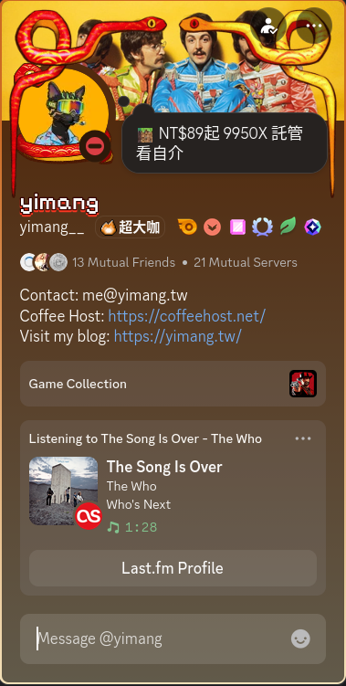

# Last.fm Discord RPC 24/7
> [!WARNING]
> This project uses a selfbot (user token), which is against [Discord's Terms of Service](https://discord.com/terms). Use at your own risk — your account may be suspended if detected.

Sync your currently playing music from Last.fm to your Discord profile in real time, 24/7, without keeping any client open.

> Modified from [Vencord LastFMRichPresence](https://vencord.dev/plugins/LastFMRichPresence).



## How It Works

The service polls the Last.fm API every 15 seconds for your currently scrobbling track and updates your Discord presence via a selfbot. It runs on a VPS so it keeps working even when your computer is off — just listen to music on any device and Discord updates automatically.

## Prerequisites

- [Last.fm](https://www.last.fm) account
- [Last.fm API Key](https://www.last.fm/api/account/create) (free)
- Discord user token (see [guide](https://gist.github.com/MarvNC/e601f3603df22f36ebd3102c1c0b284a))
- Discord Application (create at [Discord Developer Portal](https://discord.com/developers/applications))

## Setup

Copy `.env.example` to `.env` and fill in the 3 secrets:

```env
DISCORD_TOKEN=your_discord_user_token
DISCORD_CLIENT_ID=your_discord_application_id
LASTFM_API_KEY=your_lastfm_api_key
```

Edit `config.json` to set your preferences:

```json
{
  "username": "your_lastfm_username",
  "shareUsername": false,
  "clickableLinks": true,
  "hideWithSpotify": true,
  "hideWithActivity": false,
  "statusName": "some music",
  "statusDisplayType": "artist",
  "nameFormat": "song-first",
  "useListeningStatus": true,
  "missingArt": "lastfmLogo",
  "showLastFmLogo": true,
  "showAlbumCover": true
}
```

| Key | Description |
|-----|-------------|
| `username` | Your Last.fm username |
| `shareUsername` | Show a "Last.fm Profile" button |
| `clickableLinks` | Make track/artist/album text clickable |
| `hideWithSpotify` | Hide when Spotify is playing |
| `hideWithActivity` | Hide when any other activity is present |
| `statusName` | Custom status text, supports `{artist} {title} {album}` |
| `statusDisplayType` | Member list display: `"off"`, `"artist"`, or `"track"` |
| `nameFormat` | Activity name: `"status-name"`, `"artist-first"`, `"song-first"`, `"artist"`, `"song"`, or `"album"` |
| `useListeningStatus` | Show "Listening to" (`true`) or "Playing" (`false`) |
| `missingArt` | Fallback when no album art: `"lastfmLogo"` or `"placeholder"` |
| `showLastFmLogo` | Show Last.fm logo badge on album art |
| `showAlbumCover` | Show album cover art |

## Deployment

### Local

```bash
npm install
node app.js
```

### PM2

```bash
# Install PM2 globally if needed
npm install -g pm2

# Start
pm2 start ecosystem.config.js

# Save process list (auto-restart on reboot)
pm2 save

# Enable startup (run the command it outputs)
pm2 startup

# View logs
pm2 logs lastfm-sync

# Restart
pm2 restart lastfm-sync
```

### Docker

```bash
# Build and start
docker compose up -d

# View logs
docker compose logs -f

# Rebuild after config changes
docker compose up -d --build
```
